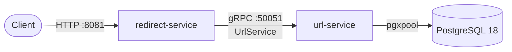

# Go URL Shortener

> **Note:** This is a hands-on learning project for building Go microservices with gRPC, PostgreSQL and Docker: designed, built and debugged step by step.

A URL shortener built as two small Go microservices that talk over **gRPC**, backed by **PostgreSQL** and run with **Docker Compose**.

- **redirect-service**: the public HTTP API. It turns JSON requests into gRPC calls.
- **url-service**: the internal gRPC service. It owns the data and the logic for generating codes.
- **proto**: the shared Protobuf contract, a Go module of its own that both services import.

---

## Table of contents

- [Architecture](#architecture)
- [Tech stack](#tech-stack)
- [Quick start](#quick-start)
- [API reference](#api-reference)
- [Configuration](#configuration)
- [Project structure](#project-structure)
- [Local development](#local-development)
- [Design decisions](#design-decisions)
- [Known limitations & roadmap](#known-limitations--roadmap)

---

## Architecture



| Component          | Responsibility                                    | Port (host → container) |
| ------------------ | ------------------------------------------------- | ----------------------- |
| `redirect-service` | Public HTTP API; gRPC client of `url-service`     | `8081 → 8081`           |
| `url-service`      | gRPC server; validation, code generation, storage | `50051 → 50051`         |
| `db`               | PostgreSQL 18 with a persistent volume            | `5432 → 5432`           |

All three containers share the `url_shortener_net` bridge network. Inside that network they reach each other by compose service name: `url:50051` and `db:5432`.

**Request flow (create):**

1. The client sends `POST /create` with `{"url": "..."}` to `redirect-service`.
2. `redirect-service` calls `UrlService.CreateURL` over gRPC, with a 5s deadline.
3. `url-service` validates the URL, generates a random code and inserts the row. If the URL or the code already exists, PostgreSQL's unique constraints reject the insert.
4. The JSON response contains the `id`, `original_url` and `code`.

---

## Tech stack

| Concern          | Choice                                                                    |
| ---------------- | ------------------------------------------------------------------------- |
| Language         | Go 1.26                                                                   |
| RPC              | gRPC + Protocol Buffers (`google.golang.org/grpc`)                        |
| HTTP             | `net/http` (Go 1.22+ method and path patterns, e.g. `GET /{code}`)        |
| Database         | PostgreSQL 18 (alpine)                                                    |
| DB driver        | [`pgx/v5`](https://github.com/jackc/pgx) with `pgxpool` connection pooling |
| Containerization | Multi-stage Docker builds (`golang:1.26-alpine` → `alpine:3.22`)          |
| Orchestration    | Docker Compose                                                            |

---

## Quick start

**Prerequisites:** Docker with Compose v2.

```bash
make build    # docker compose up -d --build
```

Check that everything is up:

```bash
docker compose ps
```

Create a short URL:

```bash
curl -X POST localhost:8081/create -d '{"url":"https://go.dev"}'
```

```json
{"code":"Xk3n9_aQ","id":"1","original_url":"https://go.dev"}
```

Look it up:

```bash
curl localhost:8081/Xk3n9_aQ
```

```json
{"code":"Xk3n9_aQ","id":"1","original_url":"https://go.dev"}
```

Other targets:

| Command      | What it does                                        |
| ------------ | --------------------------------------------------- |
| `make build` | Build the images and start everything in the background |
| `make up`    | Start the existing images                           |
| `make down`  | Stop and remove the containers (the DB volume is kept) |

---

## API reference

### HTTP (redirect-service, `:8081`)

#### `POST /create`

Creates a short code for a URL.

| Field | Type   | Required | Notes                                  |
| ----- | ------ | -------- | -------------------------------------- |
| `url` | string | yes      | Must be an absolute `http`/`https` URL |

| Status            | When                                                  |
| ----------------- | ----------------------------------------------------- |
| `200 OK`          | Created; the body has `id`, `original_url` and `code` |
| `400 Bad Request` | The body isn't valid JSON, or the URL is invalid      |
| `409 Conflict`    | The URL has already been shortened                    |
| `5xx`             | url-service failed or is unreachable (see below)      |

#### `GET /{code}`

Returns the record for a code as JSON (`id`, `original_url`, `code`).

| Status          | When                                     |
| --------------- | ---------------------------------------- |
| `200 OK`        | Found                                    |
| `404 Not Found` | No URL has this code                     |
| `5xx`           | url-service failed or is unreachable     |

#### Error mapping

Both endpoints translate url-service's gRPC status codes into HTTP statuses in one place, `writeGrpcError` in `redirect-service/internal/handler`:

| gRPC code          | HTTP                        | Body                         |
| ------------------ | --------------------------- | ---------------------------- |
| `InvalidArgument`  | `400 Bad Request`           | url-service's message        |
| `NotFound`         | `404 Not Found`             | url-service's message        |
| `AlreadyExists`    | `409 Conflict`              | url-service's message        |
| `DeadlineExceeded` | `504 Gateway Timeout`       | generic, the error is logged |
| `Unavailable`      | `503 Service Unavailable`   | generic, the error is logged |
| anything else      | `500 Internal Server Error` | generic, the error is logged |

Every gRPC call has a 5s deadline. If url-service is down, a request can wait the full 5 seconds before it gets a `504`.

> ⚠️ This returns JSON. It does not yet send an HTTP redirect. See [Known limitations](#known-limitations--roadmap).

### gRPC (url-service, `:50051`)

The contract is defined in [`proto/url/v1/url.proto`](proto/url/v1/url.proto):

```protobuf
service UrlService {
  rpc FindByCode(FindByCodeRequest) returns (FindByCodeResponse);
  rpc CreateURL(CreateURLRequest)   returns (CreateURLResponse);
}
```

| RPC          | Success                                         | Error codes                                                               |
| ------------ | ----------------------------------------------- | ------------------------------------------------------------------------- |
| `CreateURL`  | `id`, `original_url`, `code`                    | `InvalidArgument` (empty or invalid URL), `AlreadyExists`, `Internal`     |
| `FindByCode` | `id`, `original_url`, `code`, `created_at`      | `InvalidArgument` (empty code), `NotFound`, `Internal`                    |

Calling it directly with [grpcurl](https://github.com/fullstorydev/grpcurl). Server reflection isn't enabled, so pass the proto file:

```bash
grpcurl -plaintext -import-path proto -proto url/v1/url.proto \
  -d '{"url":"https://go.dev"}' localhost:50051 url.v1.UrlService/CreateURL
```

```bash
grpcurl -plaintext -import-path proto -proto url/v1/url.proto \
  -d '{"code":"Xk3n9_aQ"}' localhost:50051 url.v1.UrlService/FindByCode
```

---

## Configuration

Both services are configured entirely through environment variables. The values are set in [`docker-compose.yml`](docker-compose.yml).

**url-service**

| Variable            | Example         | Description       |
| ------------------- | --------------- | ----------------- |
| `DATABASE_HOST`     | `db`            | PostgreSQL host   |
| `DATABASE_PORT`     | `5432`          | PostgreSQL port   |
| `DATABASE_NAME`     | `url_shortener` | Database name     |
| `DATABASE_USER`     | `postgres`      | Database user     |
| `DATABASE_PASSWORD` | `secret`        | Database password |

**redirect-service**

| Variable                   | Example     | Description                 |
| -------------------------- | ----------- | --------------------------- |
| `URL_SERVICE_GRPC_ADDRESS` | `url:50051` | gRPC address of url-service |

> The credentials in `docker-compose.yml` are development defaults. Don't use them in production.

---

## Project structure

```text
.
├── docker-compose.yml          # db + url-service + redirect-service
├── Makefile                    # build / up / down
├── proto/                      # module github.com/milwad-dev/url-shortener/contracts
│   └── url/v1/
│       ├── url.proto           # source of truth for the API contract
│       ├── url.pb.go           # generated messages
│       └── url_grpc.pb.go      # generated client/server stubs
├── url-service/                # module url-service (gRPC server)
│   ├── cmd/main.go             # wiring, signal handling, graceful shutdown
│   ├── Dockerfile
│   └── internal/
│       ├── config/             # env → Config, DSN builder
│       ├── database/           # pgxpool setup, schema bootstrap
│       ├── domain/             # URL entity
│       └── server/             # gRPC server + UrlService handlers
└── redirect-service/           # module redirect_service (HTTP API)
    ├── cmd/main.go             # HTTP server, gRPC client, graceful shutdown
    ├── Dockerfile
    └── internal/
        ├── config/             # env → Config
        └── handler/            # HTTP handlers → gRPC calls
```

### Database schema

url-service creates the table on startup, if it doesn't already exist:

```sql
CREATE TABLE IF NOT EXISTS urls (
    id           serial PRIMARY KEY,
    original_url text UNIQUE NOT NULL,
    code         text UNIQUE NOT NULL,
    created_at   TIMESTAMP WITH TIME ZONE NOT NULL
);
```

---

## Local development

### Running a service outside Docker

Start only the database in Docker, then run the services with `go run`:

```bash
docker compose up -d db
```

```bash
cd url-service && DATABASE_HOST=localhost DATABASE_PORT=5432 DATABASE_NAME=url_shortener DATABASE_USER=postgres DATABASE_PASSWORD=secret go run ./cmd
```

In a second terminal:

```bash
cd redirect-service && URL_SERVICE_GRPC_ADDRESS=localhost:50051 go run ./cmd
```

### The shared `proto` module

The contracts module path (`github.com/milwad-dev/url-shortener/contracts`) isn't published anywhere. Each service resolves it from the local `proto/` directory with a `replace` directive in its `go.mod`:

```bash
go mod edit -require=github.com/milwad-dev/url-shortener/contracts@v0.0.0 -replace=github.com/milwad-dev/url-shortener/contracts=../proto
```

The Dockerfiles need `proto/` too, which is why compose builds every service with the repository root as its context (`context: .`). Each Dockerfile copies `proto/` next to the service before running `go mod download`.

### Regenerating the gRPC code

After editing `url.proto`, run this from the repository root. You need `protoc`, `protoc-gen-go` and `protoc-gen-go-grpc` installed:

```bash
protoc --go_out=. --go_opt=paths=source_relative --go-grpc_out=. --go-grpc_opt=paths=source_relative proto/url/v1/url.proto
```

Then rebuild both services. They each compile the generated code, so a contract change affects both.

---

## Design decisions

**gRPC between services, HTTP at the edge.** The internal contract is typed and versioned (`url.v1`), and both client and server are generated from one `.proto` file. Clients only ever see a plain JSON API.

**Uniqueness is enforced by the database, not by checking first.** `CreateURL` inserts the row straight away and relies on the `UNIQUE` constraints. A "does it exist? then insert" flow lets two requests for the same URL race past the check. With the constraint, exactly one wins and the rest get `AlreadyExists`. If the random code collides (`urls_code_key`), the handler retries with a new code, up to 5 times.

**Short codes.** Each code is 6 bytes from `crypto/rand`, base64url-encoded into 8 URL-safe characters. That gives 2⁴⁸ (about 2.8 × 10¹⁴) possible codes, so collisions are rare, and the retry loop handles the ones that happen.

**A connection pool, not a single connection.** A `pgx.Conn` can't be used by more than one goroutine at a time, and a gRPC server handles every request in its own goroutine. url-service therefore uses a `pgxpool.Pool`, which is safe to share.

**Graceful shutdown.** Both services listen for `SIGINT` and `SIGTERM` (`docker stop`). On a signal, each service:
1. stops accepting new requests;
2. waits up to **10s** for requests already in progress (`http.Server.Shutdown`, `grpc.Server.GracefulStop`). url-service force-stops any gRPC calls still running after that;
3. closes the downstream resource last: the DB pool for url-service, the gRPC connection for redirect-service.

Compose sets `stop_grace_period: 15s`, so Docker doesn't kill a container while it's still draining. A second `Ctrl+C` exits immediately.

**Fail fast at startup.** If url-service can't reach PostgreSQL or create the schema, it exits with a clear error instead of starting half-working.

---

## Known limitations & roadmap

- [ ] **Click tracking.** There's no `click_count` column or counter yet.
- [ ] **Schema migrations.** The table is created on startup. A migration tool (e.g. `golang-migrate`) would handle schema changes properly.
- [ ] **Tests.** There are no unit or integration tests yet. Good first targets: `CreateURL` (validation, duplicate URLs, code collisions) and the HTTP handlers.
- [ ] **Health checks.** There's no gRPC health service or HTTP `/healthz` endpoint. redirect-service's `depends_on: url` doesn't wait for url-service to be ready.
- [ ] **Security hardening.** gRPC uses plaintext (`insecure` credentials), the DB credentials are hardcoded in compose, and there's no rate limiting on `POST /create`.
- [ ] **Unused config.** redirect-service is given `DATABASE_*` variables it never reads.
